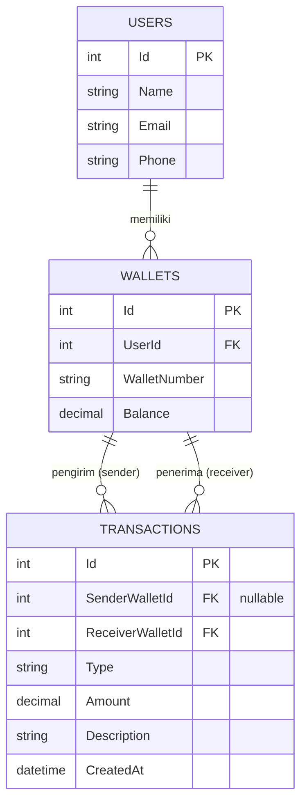
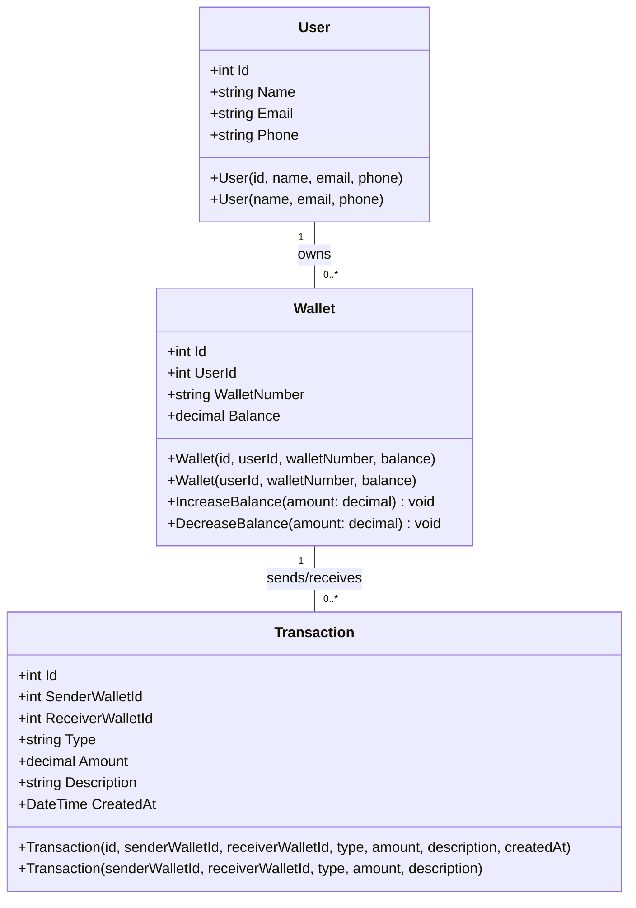
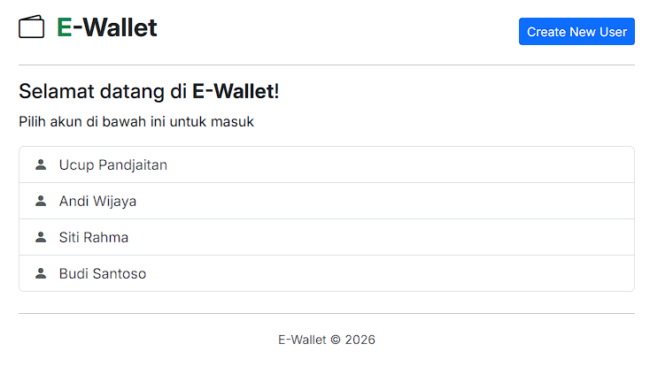
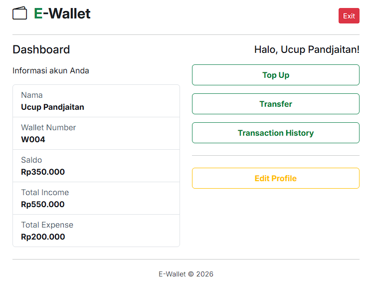
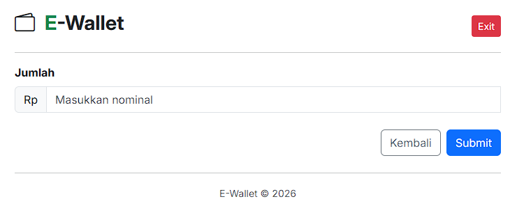
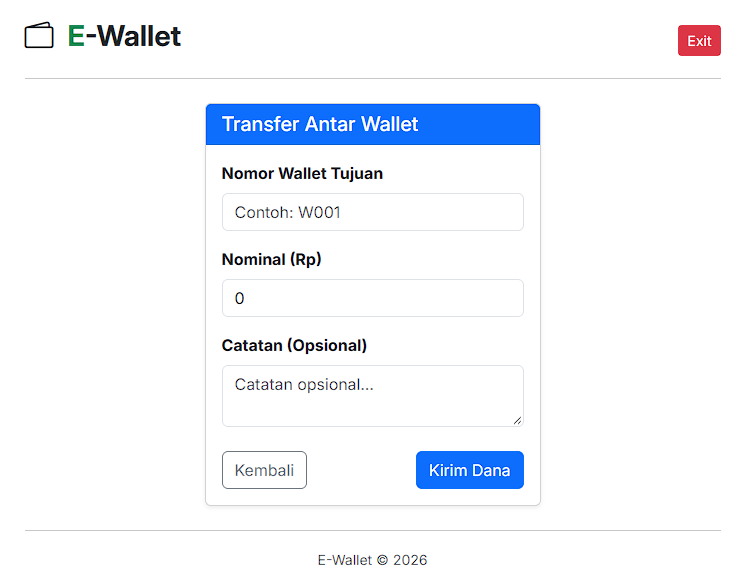
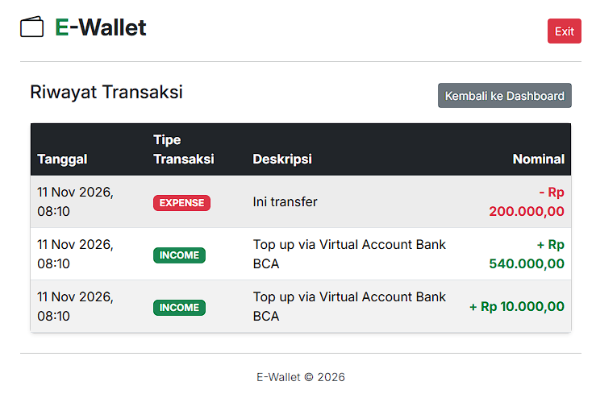

# Weekly 5 - E-Wallet RESTful API (.NET)

Implementasi RESTful API sistem E-Wallet berbasis .NET dengan arsitektur MVC (Model-View-Controller)

---

## Struktur Project

```text
Weekly5/
├── Controllers/
│   ├── UsersController.cs
│   ├── WalletsController.cs
│   └── TransactionsController.cs
├── DTOs/
│   ├── UserDto.cs
│   ├── WalletDto.cs
│   └── TransactionDto.cs
├── Models/
│   ├── Users.cs
│   ├── Wallets.cs
│   └── Transactions.cs
├── Repositories/
│   ├── Interfaces/
│   └── Implementations/
├── Services/
│   ├── Interfaces/
│   └── Implementations/
├── Data/
│   └── AppDbContext.cs
├── Properties/
│   └── launchSettings.json
├── appsettings.json
├── Program.cs
└── Weekly5.csproj
```

---

## Alur API dan Arsitektur MVC

Aplikasi menggunakan pola desain **MVC / Layered Architecture** dengan alur pemrosesan data sebagai berikut:

```text
[Client / Postman] 
       │
       ▼ (HTTP Request)
┌──────────────┐
│  Controller  │ ──── Menerima request HTTP, memvalidasi DTO, dan mengembalikan HTTP Response.
└──────┬───────┘
       │
       ▼
┌──────────────┐
│   Service    │ ──── Mengeksekusi aturan bisnis (misal: cek kecukupan saldo transfer).
└──────┬───────┘
       │
       ▼
┌──────────────┐
│  Repository  │ ──── Melakukan query & manipulasi data ke Database melalui Entity Framework/ORM.
└──────┬───────┘
       │
       ▼
┌──────────────┐
│    Models    │ ──── Memetakan entitas domain (User, Wallet, Transaction) beserta enkapsulasinya.
└──────────────┘
```

---

## Entity Relationship Diagram (ERD)



---

## Struktur Kelas Utama (Class Diagram)

Berikut diagram kelas berbasis model C# yang ada pada folder `Models/`:



---

## Daftar Endpoint API

### 1. Users Endpoint
| Method | Endpoint | Deskripsi | Request Body | Response |
|---|---|---|---|---|
| `POST` | `/api/users` | Membuat user baru | `{ "name": "string", "email": "string", "phone": "string" }` | `201 Created` |
| `GET` | `/api/users` | Mengambil seluruh daftar user | - | `200 OK` |
| `GET` | `/api/users/{id}` | Mengambil detail user berdasarkan ID | - | `200 OK` / `404 Not Found` |

### 2. Wallets Endpoint
| Method | Endpoint | Deskripsi | Request Body | Response |
|---|---|---|---|---|
| `POST` | `/api/wallets` | Membuat wallet baru untuk user | `{ "userId": int, "walletNumber": "string", "balance": decimal }` | `201 Created` |
| `GET` | `/api/wallets/{id}` | Mengambil detail wallet berdasarkan ID | - | `200 OK` / `404 Not Found` |
| `GET` | `/api/users/{userId}/wallets` | Mengambil daftar wallet milik user tertentu | - | `200 OK` |

### 3. Transactions Endpoint
| Method | Endpoint | Deskripsi | Request Body | Response |
|---|---|---|---|---|
| `POST` | `/api/transactions/topup` | Melakukan isi ulang saldo (Top Up) | `{ "receiverWalletId": int, "amount": decimal, "description": "string" }` | `200 OK` / `400 Bad Request` |
| `POST` | `/api/transactions/transfer` | Melakukan transfer antar wallet | `{ "senderWalletId": int, "receiverWalletId": int, "amount": decimal, "description": "string" }` | `200 OK` / `400 Bad Request` |
| `GET` | `/api/transactions` | Mengambil riwayat seluruh transaksi | - | `200 OK` |
| `GET` | `/api/wallets/{walletId}/transactions` | Mengambil riwayat transaksi berdasarkan wallet | - | `200 OK` |

---

## Cara Menjalankan Project

### Prasyarat
- [.NET SDK 8.0+](https://dotnet.microsoft.com/download)
- Database (SQL Server / PostgreSQL / SQLite sesuai konfigurasi `appsettings.json`)

### Langkah-langkah Running
1. Clone repositori ke komputer lokal Anda:
   ```bash
   git clone https://github.com/username/weekly5-dotnet.git
   cd weekly5-dotnet
   ```

2. Restorasi package/dependencies project:
   ```bash
   dotnet restore
   ```

3. Jalankan migrasi database (jika menggunakan EF Core):
   ```bash
   dotnet ef database update
   ```

4. Jalankan aplikasi:
   ```bash
   dotnet run
   ```

5. Akses Swagger UI di browser untuk pengujian interaktif:
   ```text
   https://localhost:5219/swagger
   ```

---

## Tampilan 
<p align="center">
  
</p>
<p align="center">
  
</p>
<p align="center">
  
</p>
<p align="center">
  
</p>
<p align="center">
  
</p>